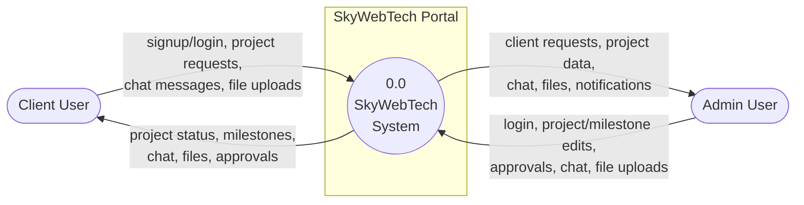
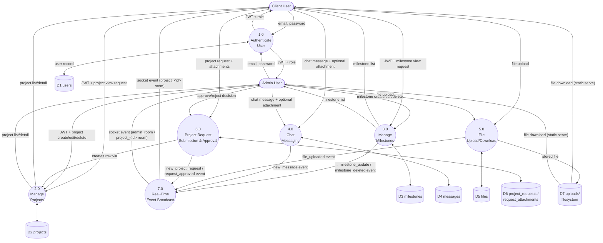

# SkyWebTech Client Portal — Project Report

## 1. Executive Summary

SkyWebTech is a full-stack client portal built for a web development agency. It combines
a marketing landing page with authenticated dashboards that let **Clients** track their
projects and **Admins** manage projects, milestones, files, and client communication in
real time. The stack is a React 19 SPA (Vite) talking to an Express 5 REST API backed by
MySQL, with Socket.IO layered on top for live chat, milestone, and file notifications.

---

## 2. Tech Stack

| Layer | Technology |
|---|---|
| Frontend framework | React 19 + Vite 8 |
| Routing | React Router 7 (client-side, `BrowserRouter`) |
| Styling | Tailwind CSS 4 + custom gradients |
| Animation | Framer Motion 12 |
| Icons | lucide-react |
| Realtime (client) | socket.io-client 4.8 |
| Backend framework | Express 5 |
| Realtime (server) | socket.io 4.8 |
| Database | MySQL (via `mysql2`, connection pool) |
| Auth | JWT (`jsonwebtoken`) + bcrypt password hashing |
| File uploads | Multer (disk storage) |
| Deployment (frontend) | Vercel (SPA rewrites in `vercel.json`) |
| Deployment (backend) | Render (referenced in `config.js` fallback URL) |

---

## 3. Application Partitions (High-Level Map)

```
/                 → LandingPage (public marketing site: Home / Services / Company / Contact)
/auth             → AuthPage (Login + Signup, toggled in one component)
/dashboard        → ClientDashboard   (Client + Admin can view; role-gated content)
/admin            → AdminDashboard    (Admin only)
```

Route protection is handled by `ProtectedRoute.jsx`, which checks `localStorage.token`
and `localStorage.userRole` and redirects unauthenticated users to `/auth`, or
mis-authorized users to their correct dashboard.


## 4. Application Flow (User Journeys)

### 4.1 Visitor → Client flow
1. Visitor lands on `/` (LandingPage) — sees hero, services, company info, contact tabs.
2. Clicks "Start Project" / "Client Portal" → routed to `/auth`.
3. Signs up (name, email, password) → backend hashes password with bcrypt, creates a
   `Client` role user, returns a JWT immediately (auto-login).
4. Redirected to `/dashboard` (ClientDashboard).
5. If they have no project yet, lands on "Add Project Details" tab to submit a project
   request (title, type, deadline, notes, file attachments) → `POST /api/requests`.
6. Request is persisted (`project_requests` + `request_attachments`) and an admin is
   notified in real time via the `admin_room` Socket.IO channel (`new_project_request`).

### 4.2 Admin request-to-project flow
1. Admin logs in → redirected to `/admin` (AdminDashboard).
2. Sees the request under "Client Requests" tab (badge count on the pill nav).
3. Clicks "Approve & Setup" → opens the 3-step Project Wizard (Core Details → Client
   Access → Milestones), pre-filled from the request.
4. On submit: `POST /api/projects` creates the project, `PUT /api/requests/:id/approve`
   marks the request approved (emits `request_approved` to the client's private room),
   then loops through wizard milestones creating each via `POST /api/milestones/project/:id`.
5. Client's dashboard picks up `request_approved` over the socket and refetches projects,
   switching them into the new project automatically.

### 4.3 Ongoing collaboration flow (both roles)
1. Both dashboards join a `project_<id>` Socket.IO room on mount.
2. Chat: messages are persisted via `POST /api/messages/project/:id`, then broadcast to
   the room as `new_message` — both sides update in real time without polling.
3. Milestones: Admin edits title/status/%, `handleSaveMilestone` PUTs to
   `/api/milestones/:id`; server re-emits `milestone_update` to the room so the client
   dashboard's progress bars update live.
4. Files: either side can drag-and-drop a file into the chat box or the dedicated Files
   tab. Upload goes through Multer (`POST /api/files/project/:id`), then a
   `file_uploaded` event tells listeners in that project room to refetch the file list.

### 4.4 Logout flow
`localStorage` (`token`, `userRole`, `userName`) is cleared client-side and the user is
routed back to `/auth`. There is no server-side token invalidation (stateless JWT).

---

## 5. Feature Requirements by Module

### Landing Page
- Animated hero with tabbed sub-pages (Home / Services / Company / Contact), no page reload.
- Service catalog, company history/stats, contact details for regional offices.
- Auth-aware navbar (shows Login vs. avatar + logout + "Dashboard" shortcut).

### Auth
- Single-page login/signup toggle.
- On success: store JWT + role + name + id in `localStorage`, redirect by role.
- No password reset flow implemented ("Forgot?" link is a placeholder `#`).

### Client Dashboard
- Multi-project switcher (dropdown) if a client has more than one project.
- **Project Progress** tab: live progress %, milestone count, deadline countdown, animated
  milestone timeline, and a real-time chat panel.
- **Files & Deliverables** tab: separate lists for admin-delivered files vs.
  client-uploaded files, drag-and-drop upload with a confirm/cancel staging step.
- **Add Project Details** tab: form to submit a brand-new project request with multiple
  file attachments, each with an editable title/description before submit.

### Admin Dashboard
- **Overview**: stat cards (active projects, total clients, pending requests) + recent
  activity feed + searchable project table.
- **Project Manager**: per-project settings editor (title/status/description/deadline),
  inline milestone CRUD with auto-alignment logic (status ↔ completion %), delete project
  (with confirm), and an admin-side chat panel identical in function to the client's.
- **Files & Assets**: admin can push deliverables to a project and review client-uploaded
  assets, scoped by a project selector.
- **Client Requests**: lists pending `project_requests` with attachments, "Review Details"
  and "Approve & Setup" actions.
- **New Project Wizard**: 3-step flow (details → client assignment → milestones) used both
  for fresh projects and for approving a client request.

### Cross-cutting
- Role-based access control (`Admin` vs `Client`) enforced both in the UI (`ProtectedRoute`)
  and in the API (`verifyToken` + per-controller ownership checks + `isAdmin` middleware).
- Real-time sync via Socket.IO rooms: `project_<id>`, `admin_room`, `client_<id>`.

---

## 6. Glossary of Terms

| Term | Meaning in this project |
|---|---|
| **JWT (JSON Web Token)** | A signed token issued at login/signup containing `{id, email, role}`. Sent as `Authorization: Bearer <token>` on every API call; verified server-side by `verifyToken` middleware using `JWT_SECRET`. Stateless — no session store, no server-side revocation. |
| **bcrypt** | Password hashing algorithm; passwords are salted and hashed before storage (`password_hash` column), never stored in plaintext. |
| **RBAC (Role-Based Access Control)** | Two roles, `Admin` and `Client`. Controllers check `req.user.role` and, for clients, additionally verify they own the `project_id` being accessed. |
| **Socket.IO** | A WebSocket-based library enabling real-time, bidirectional events between server and browser. Used here for chat messages, milestone updates, file-upload notifications, and request/approval alerts. |
| **Room (Socket.IO concept)** | A named channel sockets can join (`socket.join(room)`) so the server can broadcast (`io.to(room).emit(...)`) to only relevant clients. This app uses `project_<id>`, `admin_room`, and `client_<id>`. |
| **REST API** | The HTTP interface (`/api/...`) using standard verbs (GET/POST/PUT/DELETE) for CRUD operations on projects, milestones, messages, files, and requests. |
| **Multer** | Express middleware that parses `multipart/form-data` uploads and writes files to disk (`server/uploads/`), generating randomized filenames to avoid collisions. |
| **Connection pool (mysql2)** | A reusable set of database connections (`connectionLimit: 10`) rather than opening a new one per query — reduces latency and DB load. |
| **CORS (Cross-Origin Resource Sharing)** | Server explicitly allow-lists origins (`localhost:5173`, the Vercel domain, `FRONTEND_URL` env var) that may call the API or open a socket connection. |
| **Vite** | Frontend build tool/dev server used instead of Create React App; provides fast HMR and produces the `dist/` production bundle. |
| **SPA rewrites (`vercel.json`)** | Config telling Vercel to serve `index.html` for all paths so client-side routing (React Router) works on refresh/deep links. |
| **Optimistic UI update** | Pattern used in milestone deletion — the UI removes the item immediately, then fires the DELETE request, rather than waiting for a server response. |
| **Ownership check** | A guard (`WHERE id = ? AND client_id = ?`) ensuring a Client can only read/write resources tied to their own account. |

---

## 7. Pain Points & Risks

1. **Socket.IO has no authentication.** `io(API_URL)` connects without a token, and
   `join_admin_room` / `join_project_room` / `join_client_room` accept any id with no
   ownership or role check. Any user (or anyone who knows the API URL) can join
   `admin_room` and receive every new client request, or join any `project_<id>` room and
   receive that project's chat, milestones, and file events — even without logging in.
   This is the most significant security gap in the app since it bypasses the REST-layer
   RBAC entirely.
2. **Uploaded files are served without authorization.** `/uploads` is `express.static`
   with no auth middleware. Anyone with a file path (randomized but guessable format:
   `timestamp-random.ext`) can download it directly, regardless of project ownership.
3. **Schema/migration drift.** `init-db.js` (the "from scratch" schema) does not create
   `project_requests`, `request_attachments`, or the `attachment_url`/`attachment_name`
   columns on `messages` — those only exist via the separate `migrate-requests.js` and
   `migrate-messages.js` scripts. A fresh environment running only `init-db.js` would be
   missing tables that the controllers actively query, causing 500 errors on the
   requests and file-attachment-in-chat features.
4. **No automated migration runner.** Three scripts (`init-db.js`, `migrate-requests.js`,
   `migrate-messages.js`) must be run manually and in the right order; there's no
   version tracking to know what's applied to a given environment.
5. **No tests.** `server/package.json`'s `test` script is the default placeholder
   (`echo "Error: no test specified" && exit 1`); there is no frontend test setup either.
6. **Significant duplication** between `ClientDashboard.jsx` and `AdminDashboard.jsx` —
   nearly identical socket wiring, chat fetch/send logic, file fetch logic, and
   milestone-status-alignment logic are implemented twice with no shared hook/util.
7. **No rate limiting or brute-force protection** on `/api/auth/login` or `/api/auth/signup`.
8. **No password reset / email verification flow** — the "Forgot?" link on the login form
   is non-functional (`href="#"`).
9. **Generic error handling** — most catch blocks just `console.error` and return a
   generic 500 with `error.message`, which can leak internal error detail to clients in
   some cases (e.g., DB error messages surfaced directly in JSON responses).
10. **Leftover tooling in the repo root** — `refactor.js` is a one-off migration script
    (rewriting hardcoded `localhost:5000` to `API_URL`) that has no place in the running
    app; likely safe to delete or move to `server/scripts/`.
11. **`server/uploads/` contains real, committed user files** (docx/pdf) sitting in the
    workspace — worth confirming these are test artifacts and not real client documents,
    and that the directory is excluded from git (it is not currently listed in
    `.gitignore`, unlike `node_modules`/`dist`).
12. **No pagination** on `/api/projects`, `/api/requests`, `/api/auth/clients`, or
    `/api/messages` — every list grows unbounded and is fetched in full on every load.
13. **Admin "New Client" creation is incomplete** — the wizard's `clientMode: 'new'` path
    (`newClientName`/`newClientEmail`) is captured in state but never actually calls
    `registerClient`; only the "existing client" dropdown path is wired up.

---

## 8. Recommendations (Priority Order)

1. **Secure Socket.IO**: require the JWT on connection (`io(API_URL, { auth: { token } })`),
   verify it server-side in a Socket.IO middleware, and validate that a socket is allowed
   to join a given `project_<id>` / `client_<id>` room (mirror the REST ownership checks)
   before honoring `join_*` events. Only let `join_admin_room` succeed for `role === 'Admin'`.
2. **Gate `/uploads`** behind a route that checks the requester's JWT and confirms they
   own (or are Admin for) the project the file belongs to, instead of `express.static`.
3. **Consolidate the DB schema** into a single idempotent migration set (or adopt a
   lightweight migration tool) so `init-db.js` alone provisions a fully working schema.
4. **Extract shared logic** (chat socket wiring, milestone alignment, file fetch/format)
   from `ClientDashboard.jsx`/`AdminDashboard.jsx` into reusable hooks.
5. Add rate limiting (e.g. `express-rate-limit`) to auth endpoints and consider basic
   test coverage for the controllers before further feature work.

---

*Report generated from a full read-through of the frontend components, backend
controllers/routes/middleware, and database scripts in this repository.*

---

## 9. Requirements

Derived directly from implemented behavior in the codebase (not aspirational — each item
below maps to actual code paths in `src/` and `server/`).

### 9.1 Functional Requirements

#### FR-A. Public / Visitor
- FR-A1: The system shall display a public landing page with Home, Services, Company,
  and Contact sections navigable without authentication.
- FR-A2: The system shall show a "Log In" link to unauthenticated visitors and a
  "Dashboard"/avatar + logout control to authenticated users on the same navbar.
- FR-A3: The system shall allow a visitor to create an account (name, email, password)
  via a signup form.
- FR-A4: The system shall allow a registered user to log in with email and password.
- FR-A5: Upon successful signup or login, the system shall issue a JWT and redirect the
  user to `/admin` if their role is `Admin`, or `/dashboard` if `Client`.

#### FR-B. Client
- FR-B1: A Client shall be able to view all projects associated with their account and
  switch between multiple projects if they have more than one.
- FR-B2: A Client shall be able to view a project's overall completion percentage,
  milestone count/status, and days remaining until deadline.
- FR-B3: A Client shall be able to view a chronological milestone timeline with status
  (Pending, In Progress, Review, Completed) and completion percentage per milestone.
- FR-B4: A Client shall be able to send and receive chat messages in real time, scoped
  to a single project, including messages with file attachments.
- FR-B5: A Client shall be able to upload files to a project and view files the Admin
  has uploaded for that project, separated into "Deliverables" and "Client Assets."
- FR-B6: A Client shall be able to submit a new project request containing a title,
  project type, deadline, description, and zero or more file attachments (each with an
  editable title/description before submission).
- FR-B7: A Client shall receive a real-time notification and an automatic project-list
  refresh when their submitted request is approved.
- FR-B8: A Client shall only be able to view/modify projects, messages, and files that
  belong to their own account (enforced server-side).
- FR-B9: A Client shall be able to log out, clearing their session locally.

#### FR-C. Admin
- FR-C1: An Admin shall be able to view a dashboard overview showing counts of active
  projects, total clients, and pending client requests, plus a recent-activity feed.
- FR-C2: An Admin shall be able to view, search, and select any project across all
  clients from a project table.
- FR-C3: An Admin shall be able to edit a project's title, description, status
  (Active/Completed/On Hold), and target deadline.
- FR-C4: An Admin shall be able to delete a project (with confirmation), which cascades
  to its milestones, messages, and files.
- FR-C5: An Admin shall be able to create, edit (title, status, completion %), and
  delete milestones for any project, with status and completion percentage kept
  logically consistent (e.g., "Completed" forces 100%, reaching 100% forces "Completed").
- FR-C6: An Admin shall be able to chat with a Client in the context of a specific
  project, including sending file attachments, mirroring the Client's chat experience.
- FR-C7: An Admin shall be able to upload deliverable files to a project and view files
  uploaded by the Client for that project.
- FR-C8: An Admin shall be able to view all incoming client project requests, including
  attached files, and either approve or reject each request.
- FR-C9: Approving a request shall let the Admin provision a new project via a 3-step
  wizard (project details → client assignment → initial milestones), automatically
  marking the source request as Approved and notifying the requesting client.
- FR-C10: An Admin shall be able to create a brand-new project (not tied to any request)
  through the same wizard, assigning it to an existing client.
- FR-C11: An Admin shall be able to view a list of all registered clients.
- FR-C12: All Admin-only write actions (project CRUD, milestone CRUD, request
  approval/rejection) shall be rejected by the server for non-Admin users.

#### FR-D. Real-Time System Behavior
- FR-D1: The system shall broadcast a new chat message to all clients currently viewing
  that project in real time (no polling/refresh required).
- FR-D2: The system shall broadcast milestone creation, updates, and deletion to all
  viewers of that project in real time.
- FR-D3: The system shall broadcast a file-upload event to all viewers of that project,
  triggering an automatic file-list refresh.
- FR-D4: The system shall notify all connected Admins in real time when a Client submits
  a new project request.
- FR-D5: The system shall notify the specific Client in real time when their request is
  approved or rejected.

#### FR-E. Data Persistence Requirements
- FR-E1: The system shall persist users, projects, milestones, messages, files, project
  requests, and request attachments in a relational (MySQL) database.
- FR-E2: The system shall store passwords only as bcrypt hashes, never in plaintext.
- FR-E3: The system shall store uploaded files on disk with a randomized filename and
  record the original filename, path, uploader, and timestamp in the database.

### 9.2 Non-Functional Requirements

- NFR-1 (Security — Authentication): All non-public API endpoints shall require a valid
  JWT bearer token; requests without one shall be rejected with HTTP 401, and
  invalid/expired tokens with HTTP 403.
- NFR-2 (Security — Authorization): Role checks (`Admin` vs `Client`) and per-resource
  ownership checks shall be enforced server-side, not just hidden in the UI.
- NFR-3 (Security — Transport): The frontend shall only accept API origins explicitly
  allow-listed via CORS configuration (`localhost:5173`, the production Vercel domain,
  and `FRONTEND_URL`).
- NFR-4 (Availability): The API shall expose a health-check endpoint (`/api/health`)
  suitable for uptime monitoring by the hosting platform.
- NFR-5 (Scalability — DB): Database access shall use a connection pool (max 10
  concurrent connections) rather than per-request connections.
- NFR-6 (Usability): Dashboards shall provide immediate (optimistic or event-driven) UI
  feedback for chat sends, milestone edits, and file uploads rather than requiring a
  manual page refresh.
- NFR-7 (Responsiveness): Both dashboards and the landing page shall render usably on
  mobile viewports (dedicated mobile nav patterns exist in both dashboards).
- NFR-8 (Portability): The frontend shall be deployable as a static SPA (Vercel) fully
  decoupled from the backend, communicating only via `VITE_API_URL`/`API_URL`.
- NFR-9 (Data integrity): Foreign keys (projects→users, milestones→projects,
  messages→projects/users, files→projects/users) shall use `ON DELETE CASCADE` so
  removing a project cleans up its dependent records.
- NFR-10 (Session lifetime): Issued JWTs shall expire after 1 day, requiring re-login
  thereafter (no refresh-token mechanism currently implemented).

### 9.3 Known Gaps Against Implied Requirements

These are requirements a client-portal product of this kind would typically need but
that are **not currently implemented** (see Section 7, Pain Points, for detail):
- Authenticated/authorized Socket.IO connections and room joins.
- Authenticated access to uploaded files (`/uploads`).
- Password reset / email verification.
- Rate limiting on auth endpoints.
- Pagination for large lists (projects, requests, messages, clients).
- Automated test coverage.
- A unified, version-controlled DB migration process.

---

## 10. Data Flow Diagram

Diagrams use standard DFD notation: rounded rectangles = processes, rectangles =
external entities, open-ended shapes = data stores, arrows = labeled data flows.

### 10.1 Level 0 — Context Diagram

Shows the whole system as a single process and its external entities.



### 10.2 Level 1 — Major Processes and Data Stores

Breaks the single system process into its main functional processes, and shows the
data stores (MySQL tables + filesystem) each one reads/writes.



### 10.3 Notes on the Diagram

- **Process 7.0 (Real-Time Event Broadcast)** is not a separate business function — it's
  Socket.IO (`req.io.to(room).emit(...)`) invoked directly inside Processes 3, 4, 5, and 6
  right after their DB write commits. It's drawn separately here because, architecturally,
  it's a distinct fan-out step: one write turns into a push to every socket in a room.
- **Data store D7 (uploads/ filesystem)** is deliberately separate from D5/D6 (the `files`
  and `request_attachments` tables) because the app splits file storage: the binary lives
  on disk, and only metadata (path, uploader, filename) lives in MySQL.
- Every arrow into a process from Client/Admin that isn't login implicitly carries a JWT
  (`Authorization: Bearer <token>`) — omitted from most labels for readability, shown only
  on Process 1.0's output.
- This diagram reflects **actual code paths** (verified in `messageController.js`,
  `fileController.js`, `milestoneController.js`, `requestController.js`,
  `projectController.js`, and `server/index.js`), not an idealized design. It does not
  show the authorization gaps noted in Section 7 (e.g. Socket.IO room joins bypass JWT
  verification) — those are a control-flow concern, not a data-flow one, and are covered
  separately in the Pain Points section.
